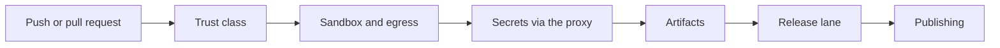

A change reaches Turntable as a push or a pull request. The controls below apply in this order. Each step narrows what the next one is allowed to do, so a weakness in an early class of work cannot reach a late, privileged one.

## 1. Trust class

Every run gets a class when it is ingested, decided from forge facts and never from pull request text: `untrusted_pr`, `trusted_pr`, `protected` or `release`. Fork pull requests wait for a human. The workflow definition comes from a ref the class allows, and a job on a privileged trigger that checks out untrusted code is demoted before anything starts. See [Trust classes](/security#trust-classes-and-fork-pr-gating) and [Workflow source and taint](/security#workflow-source-and-workspace-taint).

## 2. Sandboxes and egress

Each job runs in its own disposable sandbox from a [provider](/providers). Egress is deny by default, and `untrusted_pr` runs stay at none whatever the project allows. Actions are pinned to a commit sha before the run. A [quota](/configuration#per-org-quotas) caps what one org can use, and the control plane's own outbound requests go through one guarded client. See [Configuration](/configuration#egress) and [Action pins](/security#action-pins-and-moved-tags).

## 3. Secrets through the proxy

Only `protected` and `release` runs can use secrets. A job never holds a raw value: its traffic goes through the [secrets proxy](/secrets-proxy), which adds the credential for rules the [vault](/secrets-vault) allows, per host. A job that gets a GitHub token or a proxy credential is checked from inside its sandbox first, and a [scoped per-job token](/security#scoped-per-job-github-token) is capped by its class. Jobs can also prove who they are with [OIDC](/oidc). Values are sealed under per-org keys, see [Tenant isolation](/tenant-isolation).

## 4. Artifacts

Each artifact records the class of the attempt that made it. A release build consumes nothing a lower class could write, and the [job cache](/cache) keeps classes apart the same way. See [Artifact provenance](/security#artifact-provenance-and-quarantine).

## 5. The release lane

Signing and publishing run in a separate process that holds the signing keys and publish credentials, and the main process does not. The lane re-checks the tag and the artifact digests with the forge, and it needs [human approvals](/security#human-approvals) from enrolled approvers (two people by default for `production` and `release`) before it signs. See [Release lane](/release-lane) and [Signing](/signing).

## 6. Publishing

The lane publishes the bytes it verified to npm, GitHub Releases and a container registry, either itself (strict mode) or by holding the credential while the job pushes (compat mode). Signed provenance goes with them, and anyone can check it with `turntable verify`. See [Publishing](/release-lane#publishing) and [Releases](/releases).

## Around the path

- **Audit.** Every write, denial and approval goes into a per-org hash chain with signed checkpoints. See [Audit log](/security#audit-log-integrity-and-export).
- **Incident response.** `incident freeze` stops scheduling, kills running jobs and flags secrets for rotation. See [Incident response](/security#incident-response).
- **Agents and people.** The web UI, REST, MCP and CLI all use one [operations registry](/agent-interface), so nothing is reachable from only one of them.
- **Tenancy.** Orgs are isolated in the data layer and tested adversarially. See [Architecture](/architecture#tenancy-model) and [Tenant isolation](/tenant-isolation).
